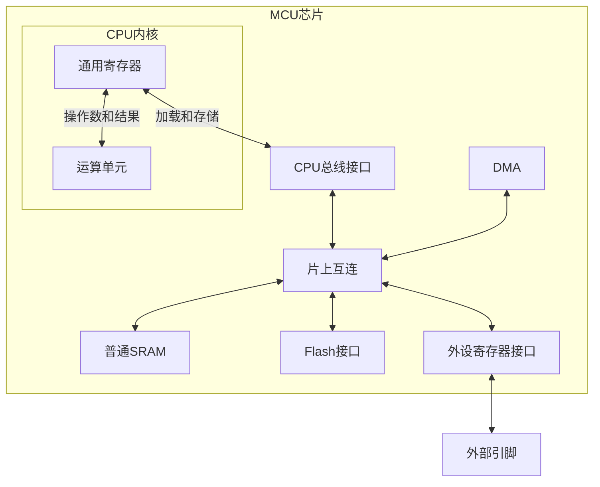
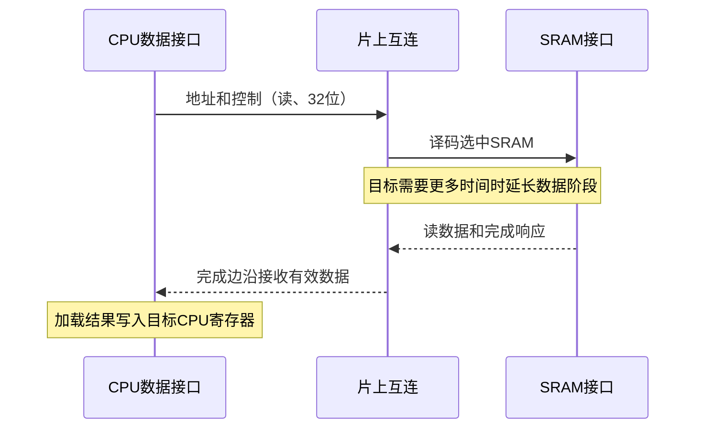
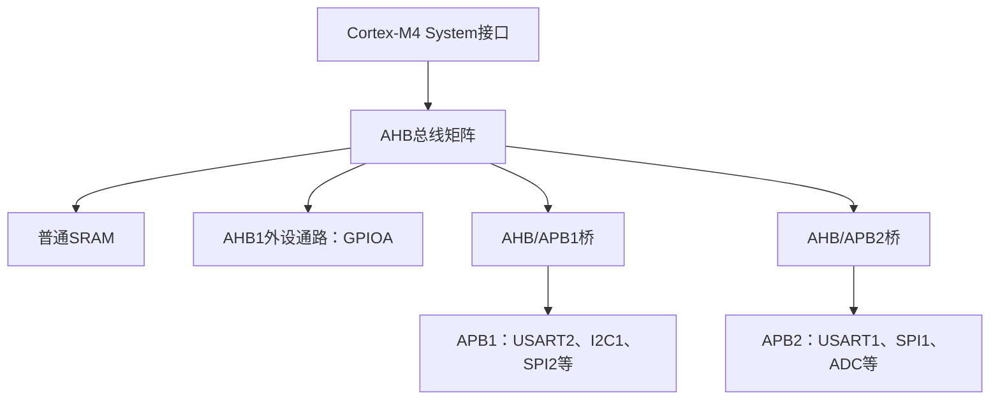
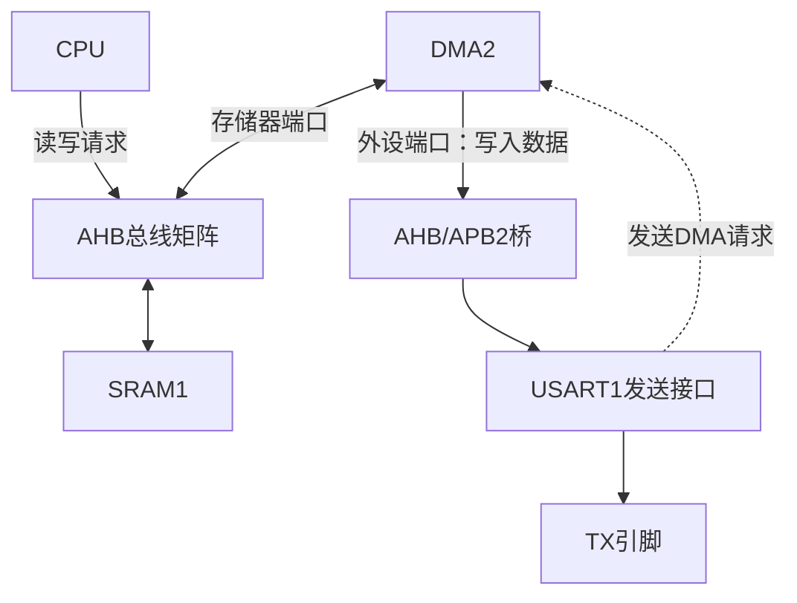

# 2.1 MCU架构及总线基础

> **所属目录**　02. 计算机与MCU底层原理  
> **学习状态**　七个知识块、课堂练习、综合验收与补验均已完成（2026-11-19），待间隔复习。  
> **语言与环境**　C11、Cortex-M4 Thumb 汇编示意、STM32F407（CMSIS 设备头文件或 STM32CubeF4 HAL）、ESP32-S3（ESP-IDF v5.5.4）。  
> **应用方向**　外设寄存器调试、UART/SPI/I2C 收发、定时采集、DMA 传输与吞吐量分析。  
> **学习目标**　根据代码和参考手册追踪指令及数据的去向，判断一次访问由谁发出、经过哪些接口、在哪里可能等待，以及哪个事件证明所需的工作已经完成。

## 1. 学习内容导引

| 阶段 | 学习知识点 | 学习目标 |
|---|---|---|
| 1 | MCU、内核、片上存储器和外设 | 区分 CPU 寄存器、SRAM、Flash、Mask ROM 与外设寄存器 |
| 2 | 取指、译码、执行与流水线 | 拆解一次加载、计算和写回，区分指令编码与操作数 |
| 3 | 总线事务、地址译码与响应 | 说清地址、方向、宽度、数据、完成和错误 |
| 4 | AHB、APB、桥与 STM32F407 互连 | 从目标地址找到访问路径，区分总线周期和代码耗时 |
| 5 | DMA、仲裁与并发 | 找到请求线、数据通路、竞争点与缓冲区使用权 |
| 6 | STM32F407 与 ESP32-S3 对照 | 区分处理器架构、芯片实现、链接布局和驱动语义 |
| 7 | 定时采集、SPI/I2C 与 UART 上传 | 串起事件、搬运和线路波形，用单位排查积压 |

## 2. 必须掌握的知识重点

1. 内核执行机器指令。Cortex-M4 的 R0 属于内核，STM32F407 的普通 SRAM 和片上 Flash 是芯片内独立于内核的存储模块。Mask ROM 可读及按设计取指，内容由制造过程固化。
2. 取指取得机器指令编码，数据访问取得或写入操作数。执行 `LDR` 时，两种读取可以分别指向 Flash 和 SRAM。ALU 做运算，结果写回指定寄存器。
3. 存储器映射 I/O（MMIO）将地址映射到外设的控制、状态或数据接口。硬件按地址译码，目标硬件按寄存器定义解释数据。
4. AHB-Lite 中 `HREADY` 表示传输进度，`HRESP` 表示响应状态。正常读事务在对应数据阶段的完成边沿接收有效读数据。总线等待由硬件处理。
5. APB 的基本阶段是 SETUP（建立）和 ACCESS（访问）。两者用 APB 时钟计量。STM32F407 的普通 SRAM 和 GPIOA 访问无需 APB 桥，USART1 走 APB2，USART2 走 APB1。
6. 轮询和中断由 CPU 供数，DMA 方式由 DMA 按配置供数。发送移位和线路波形由外设完成。区分 DMA 搬运完成、外设发送完成和对端确认。
7. DMA 流优先级、总线仲裁、NVIC 中断优先级由不同硬件使用。CPU 与 DMA 即使访问 SRAM1 的不同地址，也可能共享目标接口。缓冲区是否能改写由应用和驱动的交接规则决定。
8. ESP32-S3 的 IRAM、DRAM 是内部 SRAM 的用途或地址区域。IROM、DROM 在典型 ESP-IDF 工程中通过 Flash 映射访问。镜像中的 IRAM/DRAM 加载段经启动代码复制；烧录位置与运行地址分别核对。
9. SPI 采集间隔、单次 SCK 传输时间和 UART 每秒净发送量分别计算。DMA 降低 CPU 搬运负担，缓冲区吸收有限突发。长期吞吐取决于生产速率和可用输出带宽。

## 3. 系统知识讲解与代码分析

### 3.1 从 MCU 框图定位模块

| 模块 | 工作 | 常见实例 |
|---|---|---|
| CPU 内核 | 取指、译码、运算、发出加载或存储请求 | Cortex-M4 的通用寄存器、PC、SP、ALU |
| 片上普通 SRAM | 保存工作数据、数组、栈、堆及可放入 RAM 的代码 | STM32F407 的 SRAM1、SRAM2 |
| Flash | 断电保留固件、常量和初始化数据 | STM32F407 内嵌 Flash |
| Mask ROM | 保存出厂固化的内容 | ESP32-S3 的第一级启动代码 |
| 片上互连 | 地址译码、路由、返回响应及协调共享通路 | F407 的多层 AHB 总线矩阵及桥 |
| 外设 | 完成通信、计数、转换或引脚控制 | GPIO、USART、SPI、I2C、TIM |
| DMA、时钟与复位 | 分别负责数据搬运和模块工作条件 | DMA1/2、RCC |



框图表达功能关系，芯片实际通路查对应型号的系统架构图。FreeRTOS 在 CPU 上运行，借助中断、定时器及存储器实现调度。资料定位可查 [STM32F407 数据手册](https://www.st.com/en/microcontrollers-microprocessors/stm32f407vg.html)和 [RM0090 的 Memory and bus architecture](https://www.st.com/resource/en/reference_manual/dm00031020-stm32f405-415-stm32f407-417-stm32f427-437-and-stm32f429-439-advanced-arm-based-32-bit-mcus-stmicroelectronics.pdf)。

### 3.2 从一条指令追踪取指和数据访问

取指硬件按指令地址取机器码。译码器识别操作类型、寄存器和立即数。执行单元计算，或根据指令发起访存。以下假设函数代码位于 Flash，两个静态对象的运行地址在 SRAM，函数首次调用：

```c
#include <stdint.h>

static volatile uint32_t sample = 12u;
static volatile uint32_t result;

void calculate_once(void)
{
    uint32_t value = sample;
    result = value + 6u;
}
```

| 语句 | 工程含义 |
|---|---|
| `sample = 12u` | 非零初值通常随固件保存在 Flash，正常启动时初始化 SRAM 中的对象 |
| `static volatile uint32_t result` | 静态存储期，初始为零，典型布局位于 `.bss` |
| `value = sample` | 显式读取 volatile 对象。编译器可让局部值留在内核寄存器 |
| `result = value + 6u` | CPU 完成加法，再写入 result。示例中的 6 可以编码为立即数 |

省略地址准备和返回，汇编语义如下。实际指令与寄存器分配以反汇编为准。

```asm
LDR  r0, [r1]      ; r1 保存 sample 地址，从 SRAM 读 12
ADDS r0, r0, #6    ; ALU 计算后将 18 写回 R0
STR  r0, [r2]      ; r2 保存 result 地址，把 18 写入 SRAM
```

取得 `LDR` 编码时是取指。执行 `LDR` 时，从 R1 中的地址读取 SRAM 中的 12。读取后 `sample` 仍是 12，执行 `ADDS` 后 `result` 仍是 0，直到执行 `STR` 才将结果写回。若运行时修改 `sample`，普通赋值只作用于 SRAM，正常重启又会从初始镜像得到 12。

经典冯·诺依曼模型让指令和数据共用访问通路。经典哈佛模型分开组织指令和数据。分析现代 MCU 时应分别看**软件地址空间、内核访问接口、下游物理资源**。Cortex-M4 的 ICode、DCode、System 等接口可对应不同访问。以 F407 的典型布局为例，内嵌 Flash 的代码取指和常量读取可分别经其指令、数据接口，最后仍涉及 Flash 资源。普通 SRAM 和外设的示例访问走 System 口。Cortex-M4 的三级流水线允许不同指令的阶段重叠，依赖、分支和存储器等待都会改变实际周期数。可查 [PM0214 的处理器、存储模型和 LDR/STR 说明](https://www.st.com/resource/en/programming_manual/pm0214-stm32-cortexm4-mcus-and-mpus-programming-manual-stmicroelectronics.pdf)。

### 3.3 总线事务、地址译码与 MMIO

一次访问至少要描述目标地址、读写方向、访问宽度和访问是否有效。写入携带数据，读取等待目标返回数据。互连按地址范围选中模块，模块内部再按偏移选择存储位置或寄存器接口。

```c
#include <stdint.h>
#include "stm32f407xx.h"

/* 前提：GPIOA 已开启时钟，PA7 已配置为普通推挽输出。 */
void pa7_set(void)
{
    GPIOA->BSRR = UINT32_C(1) << 7;
}
```

F407 的 GPIOA 基址为 `0x40020000`，BSRR 偏移为 `0x18`。在典型 Cortex-M4 工具链下，上述成员访问表达对 `0x40020018` 的 32 位写入，数据是 `0x00000080`。GPIO 硬件将低半字的 bit 7 写 1 解释为置位命令，更新 ODR 的 bit 7。正常推挽输出时由输出级驱动 PA7。BSRR 支持用指定写入掩码完成置位或复位，读取输出锁存状态用 ODR。端口时钟、引脚模式、复用和外部电路仍决定最终引脚行为。地址及位语义见 [RM0090 的外设地址表和 GPIOx_BSRR](https://www.st.com/resource/en/reference_manual/dm00031020-stm32f405-415-stm32f407-417-stm32f427-437-and-stm32f429-439-advanced-arm-based-32-bit-mcus-stmicroelectronics.pdf)。



| AHB-Lite 信号 | 角色 |
|---|---|
| `HADDR`、`HWRITE`、`HSIZE`、`HTRANS` | 地址、读写方向、传输尺寸、传输类型 |
| `HWDATA` / `HRDATA` | 写数据由发起者提供，读数据由目标返回 |
| `HREADY` / `HRESP` | 完成握手与传输响应 |

正常响应时，数据阶段出现 `HREADY=0,0,1` 就有两拍等待，第三拍末在有效边沿接收。`HREADY=1` 且 `HRESP=OKAY` 表示正常完成，以 `ERROR` 结束的读取结果无效。完整错误响应有协议规定的时序。`HRESP` 是硬件总线信号，处理器收到的错误可通过异常机制反映给软件。总线等待延长同一笔事务。程序轮询会执行多次独立的寄存器读取，例如反复查询 UART 状态。信号定义见 [Arm AMBA 3 AHB-Lite IHI 0033A，第 3 和第 5 章](https://documentation-service.arm.com/static/5f914801f86e16515cdc2a27)。

### 3.4 AHB、APB 与桥

AHB-Lite 的地址和数据阶段可以流水重叠。APB 采用非流水的 SETUP/ACCESS 两段式访问，适合简单的外设寄存器接口。AHB/APB 桥在上游接受访问，在下游生成符合 APB 的访问，并按桥实现把响应返回上游。STM32 的 APB1、APB2 是两组总线的名称。目标地址直接选择对应支路。



以带 `PREADY` 的 APB 协议为例，SETUP 时 `PSEL=1、PENABLE=0`，建立地址和控制。下一拍进入 ACCESS，`PENABLE=1`。`PREADY=0` 会延长 ACCESS，地址和控制等信号按协议保持稳定。完成在 ACCESS 的有效边沿判定。无额外等待时，APB侧一次访问为两个 PCLK 周期，`PCLK1=36 MHz` 时约 55.6 ns。整条 C 语句的耗时还涉及实际指令、上游互连、桥延迟、仲裁和 CPU 实现。F407 中 AHB、APB1、APB2 上限分别为 168、42、84 MHz，工程值以实际 RCC 配置为准。资料定位见 [Arm APB IHI 0024C，第 3 和第 4 章](https://documentation-service.arm.com/static/60d5b617677cf7536a55c273)及 [ST RM0090 的 RCC 章节](https://www.st.com/resource/en/reference_manual/rm0090-stm32f407-advanced-armbased-32bit-mcus-stmicroelectronics.pdf)。

```c
#include <stdint.h>
#include "stm32f407xx.h"

/* 各外设的时钟与配置须已完成。 */
uint32_t usart2_read_status(void)
{
    return USART2->SR;
}
```

同为结构体成员访问，`GPIOA->BSRR` 写入在 AHB1 外设通路上，`USART2->SR` 读取经 APB1 桥，`USART1->SR` 读取经 APB2 桥。时钟使能对应 F407 的 `RCC->AHB1ENR`（GPIOA）、`RCC->APB1ENR`（USART2）与 `RCC->APB2ENR`（USART1）。使能后的可访问时序按参考手册和驱动处理。移植其他芯片时重新查内存映射、总线归属、寄存器宽度与时钟树。

### 3.5 DMA、仲裁与缓冲区

以 STM32F407 的 USART1 DMA 发送为例。软件设置存储器源地址、外设目标地址、方向、宽度、数据项数量、递增方式和请求映射。对于 8 位发送，源地址通常逐字节递增，每次写同一个 USART 数据接口。DMA 控制器有自己的读写端口、计数器和暂存逻辑，可按实现提前取数。USART 的 DMA 请求表示发送接口需要数据。真实待发字节由 DMA 从缓冲区读取。中断发送时则由 CPU 执行服务程序供数。



图中只强调 DMA 向 USART1 供数的主要路径。F407 的 DMA2 外设端口有到 APB2 桥的直达路径，存储器端口访问普通 SRAM 经总线矩阵，CPU 访问 USART1 的路径由上一节说明。F407 的 CCM RAM 只供 CPU 访问。把 CPU 可访问的指针交给 DMA 前，应确认 DMA 可达性。[ST AN4031 的互连、仲裁和 DMA 通路](https://www.st.com/resource/en/application_note/dm00046011-using-the-stm32f2-stm32f4-and-stm32f7-series-dma-controller-stmicroelectronics.pdf)

| 层次 | 硬件如何作决定 |
|---|---|
| DMA 流优先级 | 同一控制器中的多个流争用内部端口时，DMA 仲裁器依据流配置安排服务 |
| 互连或桥仲裁 | 多个发起者争用共享目标或通路时，由该处仲裁器安排。例如 CPU 与 DMA 访问 SRAM1 的目标接口。F407 总线矩阵采用轮转仲裁 |
| NVIC 中断优先级 | 影响 Cortex-M4 对中断的响应及抢占顺序 |

实际竞争发生在共用且不能同时服务的资源处。多个地址可落在同一个 SRAM1 接口，仍可能等待。访问不同目标且路径可以独立服务时可以并行。仲裁只负责每笔事务的顺序。如果 DMA 已读走前两个旧字节，而 CPU 在 DMA 读取后两个之前覆盖同一数组，整包会混合旧前缀和新后缀。这里要管的是**缓冲区的使用权**。提交发送前填好，直到驱动确认缓冲区可复用再覆盖。局部数组必须在异步传输期间保持有效，静态数组也需要防止并发重写。

在 F407 USART 发送中，`TXE` 表示发送数据暂存位置可继续供数，移位器此刻可能仍在工作。DMA 完成表示最后一个数据项已交给 USART。起始位、数据位和停止位由 USART 硬件产生。当前传输的 `USART TC=1` 表示最后一帧发送结束。接收端是否成功接收、校验或处理，还要由通信协议的应答语义确认。[RM0090 的 USART Transmitter 和 Transmission using DMA](https://www.st.com/resource/en/reference_manual/dm00031020-stm32f405-415-stm32f407-417-stm32f427-437-and-stm32f429-439-advanced-arm-based-32-bit-mcus-stmicroelectronics.pdf)

```c
#include <stdint.h>
#include "stm32f4xx_hal.h"

extern UART_HandleTypeDef huart1;

/* 前提：USART1 设为 8N1，DMA 与中断已配置并关联。
 * tx_data 位于 DMA 可访问的普通 SRAM，由同一个发送流程管理。
 */
static uint8_t tx_data[] = {0x11u, 0x22u, 0x33u, 0x44u};

HAL_StatusTypeDef start_demo_tx(void)
{
    return HAL_UART_Transmit_DMA(&huart1, tx_data,
                                 (uint16_t)sizeof(tx_data));
}
```

句柄给驱动提供 USART 和 DMA 关联，数组提供源地址，`sizeof(tx_data)` 在此处得到 4 个 8 位数据项。返回状态表示启动结果。STM32CubeF4 HAL 的普通非循环发送还会借助 USART 中断处理最后一帧结束，应用按驱动完成回调及错误流程管理缓冲区。使用其他驱动前核对回调语义。[STM32CubeF4 HAL UART 驱动](https://github.com/STMicroelectronics/stm32f4xx-hal-driver/blob/master/Src/stm32f4xx_hal_uart.c)

### 3.6 ESP32-S3 的代码、数据和映射

STM32F407 是单核 Cortex-M4，ESP32-S3 的主处理器是双核 Xtensa LX7。C 逻辑可复用，底层指令、寄存器、外设映射及并发模型各有实现。ESP32-S3 采用串行 Flash 访问和映射机制，Flash 可能在封装内或外接。正常 Flash 启动时，启动代码建立 Flash 映射。缓存命中可直接供应内容，未命中需要沿 Flash 路径取数。[ESP32-S3 数据手册](https://www.espressif.com/sites/default/files/documentation/esp32-s3_datasheet_en.pdf)

| 区域 | 运行时用途 | 固件或启动中的来源 |
|---|---|---|
| IROM | 通过 Flash 映射取普通应用代码 | 应用镜像中的映射代码段 |
| DROM | 通过 Flash 映射读常量和其他只读数据 | 应用镜像中的映射数据段 |
| IRAM | 从内部 SRAM 取指 | 加载型代码的字节可随镜像保存，启动时复制 |
| DRAM | 从内部 SRAM 读写运行数据 | 已初始化加载段带初始字节，普通 `.bss` 在启动时清零 |
| Mask ROM | 从片内固化存储读数据或执行代码 | 厂家固化，独立于用户应用镜像 |

这里的 DRAM 指 Data RAM，IRAM 和 DRAM 的分配可能共享部分内部 SRAM 资源。`IRAM_ATTR` 指定函数本体进入 IRAM。函数仍可调用位于 IROM 的其他函数，也可读取 DROM 的表或字符串。要验证 Flash 缓存不可用时的执行条件，需核对完整调用链和实际访问的数据。`DRAM_ATTR` 指定数据的 DRAM 运行区域。标准 v5.5.4 的 `esp_attr.h` 中没有 `DROM_ATTR`，普通只读数据按链接规则通常安排到 DROM，实际结果查 Map 和反汇编。[ESP-IDF v5.5.4 Memory Types](https://docs.espressif.com/projects/esp-idf/en/v5.5.4/esp32s3/api-guides/memory-types.html)

```c
#include <stdint.h>
#include "esp_attr.h"

static const DRAM_ATTR uint16_t correction[4] = {
    100u, 103u, 107u, 112u,
};

uint16_t IRAM_ATTR get_correction(uint32_t index)
{
    if (index >= sizeof(correction) / sizeof(correction[0])) {
        return 0u;
    }

    return correction[index];
}

/* SPI 等场景的静态候选缓冲区，额外限制查外设驱动文档。 */
DMA_ATTR static uint8_t spi_tx_buffer[64];

uint8_t *get_spi_tx_buffer(void)
{
    return spi_tx_buffer;
}
```

`IRAM_ATTR` 作用于函数的代码位置，`DRAM_ATTR` 作用于读表的运行地址，`const` 约束修改。表被保留且生成了实际读取时，CPU 从 IRAM 取本函数指令，从 DRAM 读取表。标准构建下，已初始化的表仍有初始字节保存在 Flash 镜像内的 DRAM 加载段，启动时复制到片内 SRAM。烧录时存在 Flash 与运行时读 RAM 是相容的。固件校验应按镜像或协议定义的字节范围计算。只校验映射到 IROM、DROM 的段会漏掉需要复制到 IRAM/DRAM 的加载段。ESP-IDF 应用镜像的校验和及可选 SHA-256 摘要有各自定义，自定义 CRC 需单独约定算法和覆盖范围。[ESP-IDF v5.5.4 启动流程](https://docs.espressif.com/projects/esp-idf/en/v5.5.4/esp32s3/api-guides/startup.html)和[应用镜像格式](https://docs.espressif.com/projects/esp-idf/en/v5.5.4/esp32s3/api-reference/system/app_image_format.html)

在 v5.5.4 中，`DMA_ATTR` 组合 DRAM 放置和 4 字节起始对齐。例子中的 64 个 `uint8_t` 仍占 64 字节。使用时还应核对驱动要求的长度、存储能力与对齐。应用负责控制谁持有缓冲区，谁能在完成后复用。对双核共享状态，关闭 Core 0 中断仅作用于本核，Core 1 仍可能访问。同一共享对象按任务、ISR 和 DMA 的实际参与者选择同步和交接机制。[ESP-IDF v5.5.4 属性定义](https://github.com/espressif/esp-idf/blob/v5.5.4/components/esp_common/include/esp_attr.h)和[FreeRTOS 的双核临界区说明](https://docs.espressif.com/projects/esp-idf/en/v5.5.4/esp32s3/api-reference/system/freertos_idf.html)

## 4. 工程应用与常见陷阱

### 4.1 定时读取传感器并上传

假设定时器每 2 ms 产生一次采集请求。若通过中断或 RTOS 通知启动采集，路径依次为硬件事件、CPU 响应、驱动启动事务、外设完成、结果入队。测量抖动时可把 IRQ 入口和片选动作各对应一个 GPIO 测试点。若要求实际采样时刻稳定，还要核对传感器转换周期和数据就绪行为，以及本芯片是否支持所需的硬件触发路线。

以下用假设传感器协议演示全双工 SPI。读取标志占命令最高位，寄存器地址为 `0x20`，设备在命令之后连续返回 6 字节，无额外 dummy 周期，整个事务 CS 保持低。实际命令、SPI 模式、CS 时序与占位值由器件手册确定。

```c
#include <stddef.h>
#include <stdint.h>
#include "stm32f4xx_hal.h"

extern SPI_HandleTypeDef hspi1;

/* SPI1 已初始化为主机、双线全双工、8 位、软件 NSS。
 * PB0 为低有效片选，调用方须独占本次 SPI 与片选。
 * 调用方提供至少 6 字节的可写空间。
 */
HAL_StatusTypeDef sensor_read6(uint8_t out[6])
{
    if (out == NULL) {
        return HAL_ERROR;
    }

    uint8_t tx[7] = {0xA0u};
    uint8_t rx[7] = {0u};

    HAL_GPIO_WritePin(GPIOB, GPIO_PIN_0, GPIO_PIN_RESET);
    HAL_StatusTypeDef status = HAL_SPI_TransmitReceive(
        &hspi1, tx, rx, (uint16_t)sizeof(tx), 10u);
    HAL_GPIO_WritePin(GPIOB, GPIO_PIN_0, GPIO_PIN_SET);

    if (status != HAL_OK) {
        return status;
    }

    for (size_t i = 0; i < 6u; ++i) {
        out[i] = rx[i + 1u];
    }
    return HAL_OK;
}
```

`tx[0]` 是 `0x80 | 0x20`，其余元素初始化为零。发送命令的 8 个时钟期间，主机也会从 MISO 接收一个字节，本例忽略 `rx[0]`。随后主机继续发送占位字节供 SPI 硬件产生时钟，从机返回六字节。收到的数据先经接收移位寄存器进入外设缓冲，再由 CPU 或 DMA 搬入 SRAM。阻塞调用期间局部数组仍有效。改异步 DMA 时，缓冲区要活到完成，CS 要覆盖整个事务，发送侧仍需供数。SPI 完成状态与 DMA 状态按具体驱动确认。[RM0090 的 SPI 接收、DMA 和状态标志](https://www.st.com/resource/en/reference_manual/rm0090-stm32f407-advanced-armbased-32bit-mcus-stmicroelectronics.pdf)

常见 I2C 寄存器读取则按设备协议执行 `START → 地址+写 → 寄存器地址 → repeated START → 地址+读 → 数据 → STOP`。主机读取时通常对前面数据字节发送 ACK，并在最后一字节发送 NACK 再 STOP。I2C 控制器和驱动协调地址、应答、错误与结束阶段。DMA 可以承担数据寄存器搬运。F407 的 I2C 接收尾部控制要按 RM0090 对应模式处理。

### 4.2 分别计算事件间隔、通信时长和持续吞吐

取样 500 次/s，SPI 每次交换 1 个命令字节和 6 个返回字节，SCK 为 4 MHz。UART 使用 115200、8N1，每次提交 24 B。线路上每个 UART 数据字节还带 1 位起始位、1 位停止位。

| 量 | 计算 | 结果 |
|---|---|---:|
| 采集请求间隔 | `1 / 500` s | 2 ms |
| 单次 SPI 时钟数 | `(1 + 6) × 8` | 56 周期 |
| 单次 SPI 纯线路时间 | `56 / 4 MHz` | 14 µs |
| 待上传字节产生率 | `500 × 24` | 12,000 B/s |
| UART 理论发送率 | `115200 / 10` | 11,520 B/s |
| 持续积压的下限 | `12,000 − 11,520` | 480 B/s |

若每次改为提交 22 B，输入变成 11,000 B/s，理论余量为 520 B/s。这个余量允许有限空闲及抖动。应对照实际线速、帧间间隔和应用流控验证。如果输入长期超过可持续输出，有限缓冲区最终会满。提高波特率或降低每秒提交的字节数会改变持续吞吐，使用 DMA 可以减少供数开销。ESP32-S3 的普通 UART 驱动在开启 TX 环形缓冲时，可以先将应用数据复制进软件缓冲区，再由 ISR 供给硬件 FIFO。API 返回和物理发送结束需要分别确认。[ESP-IDF v5.5.4 UART 驱动](https://docs.espressif.com/projects/esp-idf/en/v5.5.4/esp32s3/api-reference/peripherals/uart.html)

### 4.3 排查顺序

| 现象 | 优先取证 |
|---|---|
| 写 BSRR 后引脚无变化 | 核对地址、RCC、GPIO 模式、引脚复用、外部负载和实测电平 |
| USART DMA 已完成，停止发送后尾字节不完整 | 用逻辑分析仪看最后一帧，以当前 USART 的 `TC` 或已核实的驱动完成事件决定何时停发 |
| SPI 数据整体错一字节 | 对照 CS、SCK、MOSI/MISO 波形，确认命令期间返回值、dummy 周期和接收偏移 |
| SPI 硬件接收已溢出，下游数组尚空 | 查外设状态、RX 请求、DMA 可达性、宽度和搬运时机。增大下游数组只影响已搬出的数据 |
| 偶尔混入下一包的数据 | 查谁持有缓冲区、对象寿命、发送过程中是否覆盖，以及实际完成事件 |
| UART 软件队列越积越多 | 记录每秒提交 B 数、有效发送 B 数和队列水位，先判断持续带宽 |
| ESP32-S3 的 IRAM 代码仍依赖 Flash | 结合 Map 和反汇编核对被调用函数、常量、字符串和生成的跳转表 |
| 同样的代码移植后速度不同 | 区分 CPU 指令、Flash 等待或缓存、桥接、APB 时钟和外设线路速率 |

## 5. 个人易错点与复盘

| 实际易错点 | 修正与复核方法 |
|---|---|
| 将 R0 与 MCU 的 SRAM 放在同一层，或将取指称为取址 | R0 属于 CPU 内核。分别写出机器码地址、有效数据地址和结果寄存器 |
| `HREADY=0,0,1` 曾数成一次等待，将 `HRESP` 当作软件可读标志 | 数数据阶段的两拍未完成周期。完成状态由硬件联合判断，`ERROR` 的读结果无效。补验已答对 |
| APB 阶段曾写成指令、发送，或把 SRAM1 的访问串进 APB | 复核 SETUP 建立、ACCESS 访问。普通 SRAM1 直接在 AHB 矩阵的存储器一侧 |
| 把 DMA 流优先级当作 CPU 与 DMA 竞争 SRAM 的固定顺序 | 先指出竞争位置，再判断由 DMA 内部、总线矩阵或 NVIC 处理 |
| 认为 DMA 完成时停止位已进入 USART 寄存器 | 例如 DMA 写入的是 `0xA5`，USART 硬件之后产生帧位。等待本次 `TC`。补验已答对 |
| 把 `DRAM_ATTR` 的 Flash 初值说成 DRAM 映射在 Flash | 核对运行地址与镜像加载段。已初始化、保留的示例表有 Flash 初始字节，启动后从 SRAM 读。只校验 IROM/DROM 会漏掉该加载段 |
| 把命令阶段的 `rx[0]` 当作主机填入的占位字节 | MOSI 的占位值由主机发送，MISO 的内容由从机和线路状态决定。按照器件协议解释 `rx[0]` |
| 用整个采集间隔计算单次 SCK 时钟数，混淆采集次数和待发字节数 | 先写单位。单次线路用位/次除以位/s，待发量用次/s乘 B/次。最终补验独立算出 `11,000 B/s`、`11,520 B/s` 与 `520 B/s` 理论余量 |

下一次间隔复习优先用新条件短查 `HREADY/HRESP`、APB 两阶段、USART `TC`、DRAM 初值归属以及吞吐余量。对已经独立答对的地址和 DMA 使用权做少量抽查。

## 6. 复习自检（闭卷）

1. STM32F407 上某变量运行于 SRAM，执行 `LDR r0, [r1]` 的机器码位于 Flash。① 两次访问分别是什么？② R0、变量与镜像初值各在哪？③ 运行赋值后重新初始化会读到什么？
2. F407 写 GPIOA BSRR，将 PA3 置位。① 写入地址、值和典型宽度是什么？② 查状态时 USART1、USART2 分别走哪组桥？③ `HREADY=0,0,1` 且 `HRESP=OKAY` 时等待几拍？若本次最终错误，读值如何处理？
3. CPU 与 DMA 同时读取 SRAM1 不同地址。① 为什么可能竞争？② 同控制器的 DMA 流优先级能否决定本次 CPU 与 DMA 的次序？③ DMA 已交付最后一个数据字节，等哪个 USART 标志才确认线路发完？
4. ESP32-S3 中 IRAM 函数调用一个 IROM 函数，并读普通 DROM 表。① 分别发生何种 Flash 访问？② 表加 `DRAM_ATTR` 后，运行地址和初始化来源分别在哪？③ 给 TX 数组加 `DMA_ATTR` 后，怎样保护正在使用的内容？
5. 每秒采集 400 次，每次 SPI 交换 1 字节命令和 5 字节数据，SCK 2 MHz。每次待上传 28 B，UART 115200、8N1。① 采集间隔和 SPI 纯线路时长分别多少？② 待发量与理论余量是多少？③ 若把每次上传改为 30 B，是否积压，每秒至少积压多少？

## 7. 参考答案与解析

1. **①** 取得编码是取指，按 R1 地址读取 SRAM 是数据访问。**②** R0 在内核中，变量在 SRAM。非零初值对应字节通常保存在 Flash 中。**③** 普通赋值只修改当前 SRAM 对象，正常重启且完成初始化后恢复镜像指定的初值。
2. **①** `0x40020018`，`0x00000008`，示例使用 32 位写。**②** GPIOA 无需 APB 桥，USART1 经 APB2，USART2 经 APB1。**③** 2 拍等待，第三拍的完成边沿接收。若传输以错误响应结束，结果无效。
3. **①** SRAM1 目标接口共享。**②** 流优先级由 DMA 内部仲裁器使用，CPU 与 DMA 对 SRAM1 的竞争由互连仲裁。**③** 核对本次发送对应的 `USART TC=1`。
4. **①** 被调函数需要经 IROM 的 Flash 映射取指，读表经 DROM 读数据。**②** 标准构建下，保留的非零初始化示例表运行时位于 DRAM，初始字节保存在 Flash 镜像的 DRAM 加载段。**③** 仍需程序管理所有权，依据完成事件交还缓冲区。属性负责位置及起始对齐。
5. **①** `1/400 = 2.5 ms`。`6 × 8 = 48` 个 SCK，`48 / 2 MHz = 24 µs`。**②** `400 × 28 = 11,200 B/s`，理想 UART 上限 `11,520 B/s`，余量 320 B/s。**③** `400 × 30 = 12,000 B/s`，满速且无丢弃时每秒至少积压 480 B。

## 8. 本节完成标准

- [x] 能把取指、CPU 内部运算、内存读和外设写分别定位。
- [x] 能追踪 STM32F407 普通 SRAM、GPIOA、USART1/2 的路径，并判断基本等待与错误响应。
- [x] 能说明 DMA 请求、数据流、三层仲裁和缓冲区使用权，区分 DMA 完成与 USART 发送完成。
- [x] 能说明 ESP32-S3 的指令和数据位置、Flash 映射和 RAM 启动加载，以及多核共享的边界。
- [x] 能分开计算采集周期、SPI 线路耗时、UART 理论吞吐，并判断持续积压。
- [ ] 用不同频率和字节数，在下一轮闭卷中复核易错点。

本轮综合验收记录为 15 个小问中 9 项正确、5 项部分正确、1 项错误，经讲解与补验后通过。下一节为 **2.2 ARM Cortex-M内核、寄存器与异常模型**。
